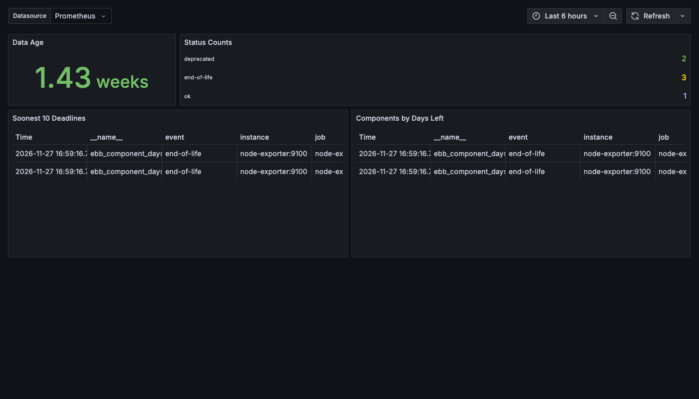

# Monitoring & OpenMetrics

Ebb exports software lifecycle data in OpenMetrics format for Prometheus and Grafana.

## Three-line setup

```bash
# 1. Cron line: evaluate dependencies daily and write metrics atomically
0 6 * * * ebb check-all /etc/ebb/sbom.json --format openmetrics > /var/lib/node_exporter/textfile/ebb.prom.$$ && mv /var/lib/node_exporter/textfile/ebb.prom.$$ /var/lib/node_exporter/textfile/ebb.prom

# 2. Textfile path: ensure node_exporter collects from this directory
node_exporter --collector.textfile.directory=/var/lib/node_exporter/textfile

# 3. Dashboard import: import dashboard from tagged URL into Grafana
# URL: https://raw.githubusercontent.com/velella-sh/ebb/v0.2.2/examples/grafana/dashboard.json
```



## Metrics Reference

The OpenMetrics export produces three metrics with bounded label cardinality:

### `ebb_component_days_left`

- **Type:** `gauge`
- **Description:** Integer days remaining until the component lifecycle event deadline. Only present when an upcoming deadline is known.
- **Labels:** `event`, `purl`, `status`, `version`
- **Example:**
  ```text
  ebb_component_days_left{event="end-of-life",purl="pkg:generic/nodejs",status="end-of-life",version="20.0.0"} 119
  ```

### `ebb_component_status`

- **Type:** `gauge`
- **Description:** Verdict of the component lifecycle evaluation. Always has value `1` for the active status.
- **Labels:** `event`, `purl`, `status`, `version` (uses `event="none"` when status is `ok` or `error`)
- **Examples:**
  ```text
  ebb_component_status{event="deprecated",purl="pkg:npm/left-pad",status="deprecated",version="1.3.0"} 1
  ebb_component_status{event="none",purl="pkg:npm/express",status="ok",version="4.21.0"} 1
  ```

### `ebb_data_age_seconds`

- **Type:** `gauge`
- **Description:** Age of the active Ebb lifecycle dataset in seconds measured from the latest review date or download date.
- **Labels:** None
- **Example:**
  ```text
  ebb_data_age_seconds 864000
  ```

## Prometheus Naming & Cardinality

The metrics follow Prometheus conventions:

- **Bounded Cardinality:**
  - `status`: Limited to the six fixed verdict strings (`ok`, `deprecated`, `unsupported`, `end-of-life`, `removed`, `scheduled`) plus `error`.
  - `event`: Limited to the six fixed lifecycle events (`deprecated`, `unsupported`, `end-of-life`, `removed`, `scheduled`, `none`).
  - `purl` and `version`: Bounded strictly by the set of packages and versions in your evaluated project or SBOM.
  - Labels never contain free-form text, error messages, or URLs.
- **Base Units:** `ebb_data_age_seconds` uses base unit seconds. `ebb_component_days_left` measures whole calendar days to match calendar date precision in vendor software lifecycles.

## Alerting

An example Prometheus alert configuration in `examples/prometheus/alerts.yml` alerts when a dependency deadline is less than 90 days away:

```yaml
groups:
  - name: ebb_lifecycle
    rules:
      - alert: ComponentDeadlineApproaching
        expr: ebb_component_days_left < 90
        for: 0m
        labels:
          severity: warning
        annotations:
          summary: "Component {{ $labels.purl }} deadline approaching"
          description: "Component {{ $labels.purl }}@{{ $labels.version }} has {{ $value }} days remaining until {{ $labels.event }}."
```
