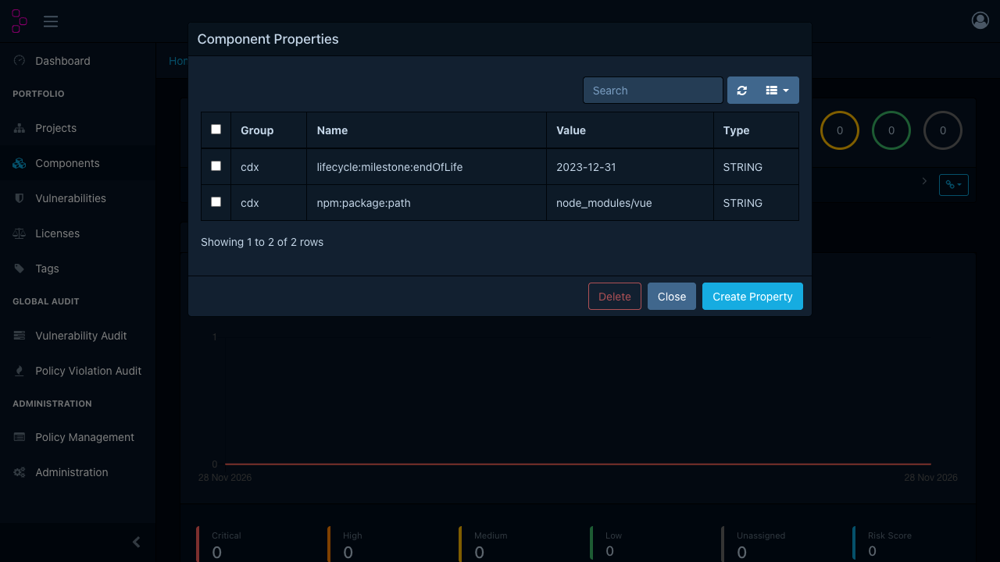

Ebb matches an SBOM component's Package URL and released version against the
active lifecycle dataset. It keeps the original document's components,
relationships, fields and order. Each matching rule contributes a reference
to its Ebb evidence record. Unidentified components are listed in the
summary, and an identified component with no matching rule stays unchanged.

Use the CLI from a release that includes enrichment.

```sh
ebb sbom enrich bom.json --out bom.enriched.json
```

Use `--format cyclonedx` or `--format spdx` to enforce the detected format.
Without `--out`, the enriched document goes to standard output and the
summary goes to standard error. With `--out`, the summary goes to standard
output. The `sbom` and `sbom-output` inputs provide the same operation in the
[Ebb GitHub Action](https://github.com/velella-sh/ebb/tree/main/action#3-enrich-an-sbom).

## Field mapping

The standards below were checked on 2026-11-28. Ebb writes typed dates only
for confirmed, day-precision milestones. Evidence comments name the rule's
event when there is no equivalent dated field or the date lacks day precision.
The [result model](/result-model/) defines the Ebb lifecycle events.

| Format | Identity | Lifecycle fields | Rule evidence |
| --- | --- | --- | --- |
| CycloneDX 1.5–1.7 JSON | `purl` and `version`, with a versioned PURL as fallback | `cdx:lifecycle:milestone:endOfLife` for end of life and scheduled end of life. `cdx:lifecycle:milestone:endOfSupport` for end of support. Values are ISO 8601 dates (`YYYY-MM-DD`). | Component `externalReferences` with type `evidence`. [CycloneDX lifecycle taxonomy](https://cyclonedx.github.io/cyclonedx-property-taxonomy/cdx/lifecycle.html) |
| SPDX 2.3 JSON | `PACKAGE-MANAGER` external reference of type `purl` and `versionInfo` | Package `validUntilDate` for a dated end of support, end of life or scheduled end of life. | An `OTHER` external reference with type `LocationRef-ebb-lifecycle`, following the standard’s `LocationRef-*` convention. [SPDX package model](https://spdx.github.io/spdx-spec/v2.3.1/package-information/) |
| SPDX 3.0 JSON-LD | Inline `software_Package` in the standard compacted graph, with `software_packageUrl` or a `packageUrl` external identifier and `software_packageVersion` | `validUntilTime` and `supportLevel: ["endOfSupport"]` for a dated end of support, end of life or scheduled end of life. | `ExternalRef` with type `eolNotice` for end of life and scheduled end of life, and `other` for the other events. [SPDX package model](https://spdx.github.io/spdx-spec/v3.0.1/model/Software/Classes/Package/), [support levels](https://spdx.github.io/spdx-spec/v3.0.1/model/Core/Vocabularies/SupportType/), [external reference types](https://spdx.github.io/spdx-spec/v3.0.1/model/Core/Vocabularies/ExternalRefType/) |

The SPDX timestamp fields serialize the Ebb calendar day at UTC midnight.
Deprecation, removal, end of active support and end of extended support
keep their own evidence references. An Ebb reference's comment identifies
values written by Ebb, letting a later run replace those values while retaining
producer-supplied fields. If an existing producer field uses the same standard
name, Ebb preserves it and contributes its rule reference.

The summary counts `checked` components and `enriched` components with
matching rules. The `notIdentified` list contains component names when the
PURL or version is missing, invalid or inconsistent. The CLI works offline
and does not expand remote JSON-LD contexts. Enrichment changes the document
bytes, so regenerate any signature that covers those bytes.

## CycloneDX compatibility

The test suite validates both the original and enriched CycloneDX 1.6 and
1.7 fixtures with the official schemas, copied byte-for-byte from the
[1.6 schema release](https://github.com/CycloneDX/specification/tree/1.6/schema)
and [1.7 schema release](https://github.com/CycloneDX/specification/tree/1.7/schema)
on 2026-11-28 along with their referenced schemas. The fixtures were
generated from a public two-dependency npm lockfile using
[CycloneDX npm 7.0.1](https://github.com/CycloneDX/cyclonedx-node-npm/releases/tag/v7.0.1)
in reproducible mode.

The [CycloneDX example](https://github.com/velella-sh/ebb/tree/main/examples/cyclonedx)
can also write an enriched SBOM.

### Verified Dependency-Track import

In a local Dependency-Track 4.13.6 instance, the enriched CycloneDX 1.6
fixture imported 14 components. In the fixture project, open
**Components → vue 2.7.16 → View Details → Properties**. The row in group
`cdx` shows `lifecycle:milestone:endOfLife` with value `2023-12-31`.
The imported component also carries the Ebb rule URL as an external
evidence reference. The value is imported SBOM metadata.


